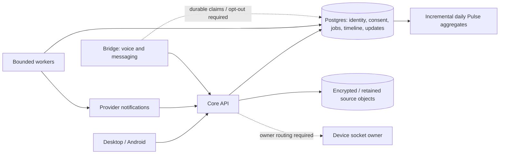

# Vox codebase audit — 10 October 2026

What this repo does: Vox collects personal activity through connectors and clients, builds a typed timeline, exposes analytics through Pulse, and operates conversational and action agents through Core, Bridge, desktop and Android.

Assumed load: multiple users, concurrent voice sessions, overlapping connector jobs, large historical imports, one year of timeline data, and eventual deployment with more than one API/worker/Bridge replica. These are review scenarios, not measured production capacity.

## Outcome

The direction is sound, but the current implementation is not ready for dependable financial analytics or unconstrained horizontal scaling. The most urgent problems are incorrect financial facts, Gmail ingestion continuing after a pause, process-local delivery/opt-out state, unbounded native voice buffering, and a failing fresh-database CI gate. Adding infrastructure capacity before fixing state ownership and work admission would amplify several failures.

This is a source and targeted verification audit. Runtime implementation was not changed. The report distinguishes reproduced errors from source-traced failure scenarios and planned functionality that has no producer yet.

## Coverage and evidence

| Area | Reviewed paths and concerns | Coverage limit |
| --- | --- | --- |
| Core | API authentication, timeline/updates, Gmail, attachments, job leases, Pulse, realtime hubs, migrations and CI | Critical paths traced; not every tool or SQL query exercised |
| Bridge | Notification delivery, WhatsApp receipts/opt-out, voice session ownership and health | No real calls or external messages sent |
| Connections | Gmail credential refresh and connection preferences; comparison with fenced provider refresh | No provider account authorization changes |
| Desktop | Tauri session persistence, native voice API contract, timeline date rendering, terminal command execution, lint | Native UI and microphone not exercised during this audit |
| Android | Timeline date handling, local historical email review, credential storage and networking structure | No device replay or fresh build during this audit |
| Deploy / Edge | Migration bootstrapping, backup/restore boundaries, readiness and routing | Production reset, restore and deployment were not performed |
| Shared / Web / desktop-control / Share to Action | Contract surfaces, marketing/privacy copy, action boundaries and public-URL fetching | Shallower coverage than Core; no exhaustive visual or action audit |
| Intro / peripheral artifacts | Outside critical product runtime | Not reviewed in detail |

Current checks:

- Desktop lint passed with zero errors and four hook warnings. Web lint passed.
- GitHub Core run [38052158751](https://github.com/vox-suite/vox-core/actions/runs/38052158751), for current commit `4b5ba09784d99b3065e5c9dcbba05c7c8ed30286`, finished **failed** in the PostgreSQL migration smoke test: `20261009000001_foundation.sql:2541: ERROR: role "authenticated" does not exist`.
- A disposable local PostgreSQL database with roles already present failed the same baseline later because schema `auth` did not exist. Together these expose the baseline's managed-Supabase prerequisites.
- An external temporary Rust probe called the current compiled financial extractor with synthetic text. A ₹1,23,456.78 receipt returned amount `1.0`; a ₹10,000 credit-card repayment and a ₹500 refund both returned `direction="debit"` and `is_spending=true`.
- Earlier successful builds and unit checks are useful background, not a fresh end-to-end validation of these findings. Ignored integration tests and a green compiler cannot establish queue, consent, migration or provider correctness.

## Must fix

### 1. Financial extraction silently changes money and transaction meaning

**What this is:** PDF facts drive financial timeline events and downstream spending analytics. Evidence: `vox-core/src/attachments/pdf.rs:120`, `:148`, `:212`.

**Problem:** The amount regex accepts a prefix of Indian digit grouping: `1,23,456.78` becomes `1`. Receipt detection also defaults to debit/spending, so the reproduced repayment and refund are incorrectly counted as spending; extracting a single amount does not produce a statement transaction ledger.

**Fix:** Parse the complete currency token, support validated Indian and Western grouping, and store exact decimal/minor-unit amounts. Explicitly classify purchases, refunds, transfers and card repayments; send ambiguous documents to review and implement statement line extraction before claiming statement-based spending coverage.

**If skipped:** Financial totals can be wrong by orders of magnitude and repayments can double-count existing purchases. Acceptance: the three synthetic examples must preserve the full amount and correct economic meaning, with uncertain cases clearly excluded from confirmed spending.

### 2. Gmail's timeline pause flag does not stop live ingestion

**What this is:** Connection preferences expose `sync_timeline`, but live Gmail selection uses authorization state. Evidence: `vox-core/src/gmail_sync.rs:250`, `vox-core/services/api/routes/gmail.rs:187`.

**Problem:** Both reconciliation and push routing select authorized Gmail accounts without checking the pause flag. An in-flight fetch can also proceed to writes after preferences or authorization change unless the transaction checks the current consent generation.

**Fix:** Enforce the preference in all ingestion entry points and recheck authorization, pause state and credential/consent generation immediately before committing. Define resume behavior explicitly so a pause does not unexpectedly become historical backfill.

**If skipped:** Users can pause sync and still receive newly persisted email-derived data. Acceptance: pause before and during a fetch must prevent subsequent timeline writes.

### 3. Native voice has no cumulative utterance memory bound

**What this is:** The native voice WebSocket accumulates binary audio until a turn or interrupt message. Evidence: `vox-core/services/api/routes/voice.rs:563`, `:842`; a related unbounded output buffer exists in `vox-desktop/src-tauri/src/terminal.rs:64`.

**Problem:** Repeated individually valid frames grow `pending_audio` without an overall byte or duration limit. Terminal output likewise grows without a cap, and its command timeout does not terminate the command.

**Fix:** Add cumulative audio size/duration limits, session quotas and backpressure. Use bounded terminal output with truthful truncation; interrupt or terminate timed-out command process groups before accepting the next command.

**If skipped:** A stalled or abusive session can exhaust memory, and timed-out desktop work may continue behind later commands. Acceptance: continuous synthetic input reaches a controlled limit without increasing process memory indefinitely.

### 4. Interrupting native voice does not invalidate already queued audio

**What this is:** Native TTS frames pass through a 64-item outbound channel. Evidence: `vox-core/services/api/routes/voice.rs:119`, `:475`, `:646`.

**Problem:** Interrupt cancels the producer, but queued binary frames carry no response generation and the writer sends them without checking cancellation. A slow client can therefore receive old speech after an interruption.

**Fix:** Attach a response generation to every frame and drop stale frames at the final writer. Prioritize interruption/control messages and flush client playback for the old generation.

**If skipped:** Barge-in feels unreliable and users can hear an obsolete answer. Acceptance: interruption while the outbound queue is backed up must prevent any further old-generation audio from being written.

### 5. Gmail refresh bypasses credential generation fencing

**What this is:** Gmail's token accessor refreshes credentials outside a transaction. Evidence: `vox-connections/src/accounts.rs:951–1025`; compare the fenced persistence path around `:1828`.

**Problem:** The final Gmail update matches connection/user IDs but not the credential generation or current authorization state. A slow old refresh can overwrite credentials after disconnect/reconnect; a returned replacement refresh token is not handled through the normal fenced lifecycle.

**Fix:** Reuse a leased, generation-fenced refresh path, recheck authorization at persistence, and retain replacement refresh tokens when supplied. Treat invalid grants as an authorization state requiring reconnection.

**If skipped:** Intermittent connector failures and stale credentials can survive a successful reconnect. Acceptance: an old refresh completion must not change a newly authorized connection.

### 6. Notification deduplication and opt-out are not durable

**What this is:** Bridge keeps notification receipts and opt-out state in process-local maps. Evidence: `vox-bridge/src/state.rs`, `vox-bridge/src/channels/notifications.rs:351`, `:517`, `:577`, and the WhatsApp webhook STOP/START handling.

**Problem:** Deduplication checks happen before the provider request and insertion happens afterward, allowing concurrent duplicates. A restart or a different replica loses the relevant dedupe and opt-out state.

**Fix:** Persist opt-out in the authoritative database and check it immediately before delivery. Atomically claim a unique delivery attempt with fenced ownership, retain actual provider IDs, and classify uncertain outcomes rather than blindly resending.

**If skipped:** Users can receive duplicate messages or notifications after opting out. Acceptance: concurrent duplicate requests, restart, and a second replica must preserve one accepted delivery and the user's opt-out.

### 7. WhatsApp receipts are fabricated instead of provider-issued

**What this is:** The notification wrapper returns a receipt after the WhatsApp client succeeds. Evidence: `vox-bridge/src/channels/notifications.rs:92`, `vox-bridge/src/channels/whatsapp/client.rs`.

**Problem:** It constructs `wamid_<random UUID>` rather than reading Meta's response message ID. The underlying client discards the successful response body, so delivery callbacks cannot reliably correlate with the returned receipt.

**Fix:** Return and persist the actual provider message ID. Separate accepted, delivered, failed and uncertain states; avoid retrying ambiguous transport failures as though no send occurred.

**If skipped:** Delivery evidence and user-visible status are misleading, and retries can duplicate messages. Acceptance: every successful receipt corresponds to the provider response and can be matched to a callback.

### 8. The fresh migration baseline cannot pass its CI environment

**What this is:** CI applies the migration files to a fresh plain PostgreSQL service. Evidence: `vox-core/.github/workflows/pr-checks.yml`, `vox-core/migrations/20261009000001_foundation.sql:2541`, `:2714`, and the security-defaults migration.

**Problem:** The baseline assumes managed Supabase roles and `auth.uid()` infrastructure that CI does not create. The current main revision's migration job demonstrably fails.

**Fix:** Add an explicit test/self-hosted bootstrap for required compatibility roles and auth helpers, separate from production migrations. Preserve Supabase-managed objects in production and verify the intended fresh deployment environment, not only the developer database.

**If skipped:** Green compilation can accompany a database that cannot initialize, leaving the release gate unusable. Acceptance: the complete baseline succeeds from empty databases in CI and the supported self-hosted configuration.

### 9. More replicas break device command and voice session routing

**What this is:** Core's device/pending-command registry and Bridge's call context are in-memory ownership maps. Evidence: `vox-core/src/realtime.rs:81`, `:251`, `vox-core/services/api/routes/internal.rs`, `vox-bridge/src/state.rs` and Twilio session routing.

**Problem:** A device socket on API A cannot receive a command handled on API B. A call context created on one Bridge instance is unavailable to a media connection on another; PostgreSQL event notifications do not solve these command/session ownership problems.

**Fix:** Start with explicit owner routing or stickiness with failure semantics, then add broker-backed instance-to-instance dispatch and durable presence as needed. Keep command acknowledgments and idempotency authoritative across instances.

**If skipped:** Increasing replica count causes intermittent missing devices or call context rather than reliable extra capacity. Acceptance: two-instance tests must exercise cross-instance command dispatch, reconnect and voice setup.

### 10. Desktop duplicates authentication secrets into a plaintext file

**What this is:** Desktop stores sessions using the keychain and a file fallback/duplicate. Evidence: `vox-desktop/src-tauri/src/session_store.rs:113`; local sign-out is in `auth.rs:482`.

**Problem:** The JSON file contains authentication and refresh material even when an OS credential store is available; filesystem permissions are not encryption. Sign-out clears local state without demonstrating server-side revocation of the corresponding session family.

**Fix:** Keep secrets in the OS credential store; use an encrypted, atomically created restricted fallback only where necessary. Implement server-side session revocation and verify that old session credentials stop working after sign-out.

**If skipped:** Reading the application file can expose reusable credentials, and a copied token may survive local logout. Acceptance: no plaintext refresh token is left on disk and a revoked session is rejected by the API.

## Should fix

### 11. Attachment work holds database locks across slow parsing

**What this is:** Attachment processing opens a transaction and then reads objects and parses PDFs. Evidence: `vox-core/src/attachments/processor.rs:39`, `:520`.

**Problem:** Network fetches and repeated password/parser attempts hold row locks and a pool connection. Timing out a `spawn_blocking` join does not stop the parser; timed-out work can retain both parsing permits and starve later attachments.

**Fix:** Claim with a short transaction, perform external work outside the transaction, and persist results using fenced ownership. Run parsing with enforceable process-level time/resource limits so cancellation frees capacity.

**If skipped:** One difficult document can block unrelated processing and consume the database pool. Acceptance: an intentionally stalled parser is terminated and subsequent jobs continue within a bounded delay.

### 12. Losing a job lease does not stop its old executor

**What this is:** Generic worker claims and heartbeat logic manage ownership/expiry. Evidence: `vox-core/src/db/jobs.rs:56`, `vox-core/src/workers/mod.rs:106`.

**Problem:** A failed heartbeat breaks the heartbeat loop without cancelling the handler. Completion ownership checks cannot undo an external effect or write already performed by a stale executor after another worker claims the job.

**Fix:** Use a monotonically increasing lease generation in every queue and fence result writes against it. Propagate lease loss to cancellation; use effect-specific idempotency and per-job deadlines for work that cannot be rolled back.

**If skipped:** Lease expiry under load can produce duplicate side effects and conflicting outcomes. Acceptance: worker A loses its lease, worker B succeeds, and A cannot publish an effective result afterward.

### 13. Gmail notification handling performs too much synchronous work

**What this is:** Push-triggered delta processing fetches messages and attachments before completing the cursor update. Evidence: `vox-core/src/gmail_sync.rs:68`, `:330`, `:347`.

**Problem:** Slow provider/object calls extend handling and transaction lifetimes. A permanently unprocessable item can keep a batch from advancing, creating repeated work for healthy messages behind it.

**Fix:** Verify and durably coalesce the notification, then acknowledge promptly and process through bounded jobs. Record per-message outcomes, quarantine permanent failures into Updates, advance the cursor safely, and apply per-message and per-connection work budgets.

**If skipped:** Provider retries amplify traffic while one bad item delays live delivery. Acceptance: a deleted/unprocessable message does not indefinitely block later valid mail, and transient failures remain retryable.

### 14. Pulse cache strategy degrades under continuous ingestion

**What this is:** Pulse combines raw inventory scans, revision-based cache keys and persisted aggregates. Evidence: `vox-core/src/storage/pulse.rs:160`, `:524`, `vox-core/src/application/pulse/service.rs:79`, and Pulse execution.

**Problem:** Inventory can scan a year before admission control; every timeline revision invalidates user-wide aggregates. Period-specific rollups limit reuse, while several sequential cold charts can exceed the overall request deadline during ongoing writes.

**Fix:** Maintain reusable daily aggregates and invalidate only affected event types/dates. Gate inventory work, use explicit query-cost limits, and return per-chart results/errors with bounded parallel execution rather than making an entire dashboard depend on the slowest cold batch.

**If skipped:** A quiet warmed benchmark looks fast while an actively syncing user's dashboard repeatedly goes cold. Acceptance: benchmark one-year data with concurrent writes, multiple users and changing date windows; measure database work, cache hit rate, response p50/p95 and partial failures.

### 15. Pulse invalidation backlog has no bounded lifecycle

**What this is:** An invalidation table feeds recurring aggregate maintenance. Evidence: `vox-core/migrations/20261009000006_pulse.sql` and `vox-core/src/storage/pulse.rs:524`.

**Problem:** The pending selection filters by `processed_at IS NULL`, but the reviewed table lacks a matching pending partial index and processed rows are not cleaned up. Multiple invalidation producers also create avoidable repeated work.

**Fix:** Add a pending partial index, coalesce equivalent dirty ranges, and prune completed invalidations under a defined retention policy. Monitor backlog age and processing throughput, not just worker liveness.

**If skipped:** Imports and ordinary usage grow maintenance cost over time. Acceptance: backlog drains after a large import and query plans remain bounded after substantial processed history.

### 16. Date-only facts are treated as UTC instants

**What this is:** PDF dates become midnight UTC and timeline clients localize timestamps. Evidence: `vox-core/src/attachments/pdf.rs:262`, `vox-desktop/src/components/timeline-view.tsx` and Android timeline date grouping.

**Problem:** A date-only event can appear on the previous day in a negative UTC offset. Month/year precision also needs different display semantics rather than presenting a full calendar day the source never supplied.

**Fix:** Preserve a canonical local date and precision separately from an actual instant, or define explicit source-timezone intervals. Group/filter/render according to the source precision and display month/year facts accordingly.

**If skipped:** Historical reports disagree with documents and date filters exclude relevant events. Acceptance: day-only and month-only records retain their meaning across India and negative-offset timezones.

### 17. Updates supports planned types without the producers

**What this is:** Updates has typed validation for briefings and daily plans, while actual writers primarily cover ingestion and attachment outcomes. Evidence: `vox-core/src/domain/updates.rs`, `vox-core/src/storage/updates.rs:620`, `:666`, and worker scheduling paths.

**Problem:** A schema and UI can accept a briefing without a scheduled, provenance-aware producer that generates it. Weekly reports, curated market summaries and daily planning remain product work; ordinary email notices also need curation to avoid overwhelming the page.

**Fix:** Deliver one complete producer at a time with source evidence, deduplication, freshness, user preferences and cost limits. Make unavailable report types explicit and keep retries/password correction tied to actual actionable job state.

**If skipped:** The new Updates page promises more than its backend supplies. Acceptance: each enabled widget has a real producer, a failure state and an observable schedule; this is a planned gap, not proof of a failed deployed feature.

### 18. Backup scripts do not establish complete production recovery

**What this is:** Deploy scripts dump/restore the self-hosted database and label its durable-state coverage. Evidence: `vox-deploy/scripts/backup.sh`, `vox-deploy/scripts/restore.sh`.

**Problem:** Restoring a database does not restore its attachment objects, credential encryption keys or managed-auth/provider configuration. The reviewed scripts alone do not prove recovery of the actual Supabase/Railway deployment.

**Fix:** Define production RPO/RTO and an inventory covering database, retained objects, encryption-key recovery and managed configuration. Exercise restore in an isolated environment through attachment decryption, token refresh and a retried job.

**If skipped:** A successful SQL restore can still leave credentials unreadable and source attachments missing. Acceptance: recover a usable product slice rather than merely a database with the expected table count.

### 19. Web-scoped tokens exclude the redesigned API paths

**What this is:** Core mints restricted web tokens and uses a route prefix allowlist. Evidence: `vox-core/services/api/auth.rs:20`, `:152`, `vox-core/services/api/routes/auth.rs:242`.

**Problem:** The allowlist retains `/v1/me/charts` but excludes canonical timeline, updates and Pulse endpoints. Requests to those endpoints using a web-scoped token are rejected even when the user owns the data; the extent of current browser-client use was not runtime verified.

**Fix:** Define the intended browser capability contract and add the precise new routes/operations required by it. Keep restrictions intentional; do not replace the allowlist with unrestricted prefix access.

**If skipped:** New browser surfaces cannot use their intended restricted token consistently. Acceptance: positive and negative authorization checks cover the redesigned routes and explicitly forbidden operations.

### 20. Readiness and operating signals do not expose essential failure modes

**What this is:** Bridge uses the same unconditional response for live/ready, and Edge has a static health response. Evidence: `vox-bridge/src/app.rs:21`, `:55`, `vox-edge/Caddyfile:15`; worker and queue operating paths.

**Problem:** These responses can remain healthy while dependencies or essential background tasks cannot perform work. Existing voice timing logs are valuable, but they do not establish measured greeting/turn percentiles, active-worker health, queue age or ingestion lag.

**Fix:** Keep liveness cheap and make readiness reflect the service's essential capability with bounded, cached checks. Add task supervision and structured metrics for stage latency, first substantive audio, dropped stale frames, reconnects, pool wait, job lease loss, backlog age, provider rate limits and Pulse cold/warm work; redact logs and bound client log ingestion.

**If skipped:** Deployments and users discover failure before monitoring does, while latency explanations remain anecdotal. Acceptance: dependency/task failures change the appropriate signal, and a long-session trace can correlate each turn across client, Core, Bridge and provider stages.

## Recommended implementation order

1. Correct financial facts and prevent bad historical facts from remaining indistinguishable from verified ones. Keep ambiguous amounts/directions out of confirmed analytics.
2. Fix the failing database gate, Gmail consent enforcement, refresh fencing, durable notification claims/opt-out and real provider receipts.
3. Bound voice/terminal/parser resources; make interruption generations and job lease loss enforceable.
4. Establish two-instance ownership/routing before scaling replicas. Move live Gmail work onto bounded durable jobs.
5. Make Pulse incremental, index/prune invalidations and benchmark active ingestion, not only cached reads.
6. Finish date semantics and complete selected Updates producers; exercise complete disaster recovery and instrument latency/queue behavior.

## Architecture recommendation

Keep PostgreSQL as the timeline authority. Typed event metadata plus validated JSON content can support varied event shapes; add narrow indexed projections and reusable aggregates for actual query patterns. Moving to MongoDB would not resolve consent, job fencing, resource bounds, delivery deduplication or process-local routing.

Keep Core as the authority for identity, consent, jobs and durable outcomes; Bridge owns transport-specific session execution; connectors own provider adapters; clients own local review and device actions. Avoid adding another generic orchestration layer until ownership and retry semantics are explicit.

## Maintenance and product follow-through

Do not resolve complexity by splitting repositories further. First split responsibilities within the large modules, consolidate duplicated credential/job lifecycle paths, and keep generated API contracts current. Pair contract changes with supported-client behavior and authorization checks.

Additional reviewed concerns to fold into the above work include hook dependency warnings, log retention/redaction, precision-aware Android rendering, and privacy/connector descriptions that must match expanded Gmail storage behavior. These are follow-through items, not claims of independently reproduced security exploits.

Validation should emphasize meaningful integration and fault scenarios: migration from empty state, consent revoked mid-fetch, credential reconnect races, lease loss, interrupted queued speech, provider accepted-but-response-lost delivery, two-instance device routing, malformed/slow attachments, and Pulse under continuing writes. Passing helper tests is insufficient; no new tests were added in this audit.

## Verdict

**Needs changes before reliable financial analytics and multi-replica expansion.** Several core boundaries are already good: Postgres ownership/RLS, validated event schemas, real provider provenance, encrypted connector credentials on established paths, explicit local historical-email review, and bounded Pulse query shapes. The issues above are repairable without replacing the architecture.

**Lean:** No code was removed or rewritten, so no measured code/cost savings are claimed. The highest-value simplifications are one fenced credential lifecycle, one durable delivery-claim mechanism, one lease contract and one reusable aggregation strategy.

**Not checked:** Production throughput or capacity, live voice/greeting p50/p95, actual Gmail delivery and provider quotas, real financial documents, native device UX, full tenant-isolation penetration testing, dependency CVEs, every agent tool, managed backup guarantees, and an exhaustive file-by-file review. No production data was changed, connector access granted, messages sent, or deployment performed during this audit.
